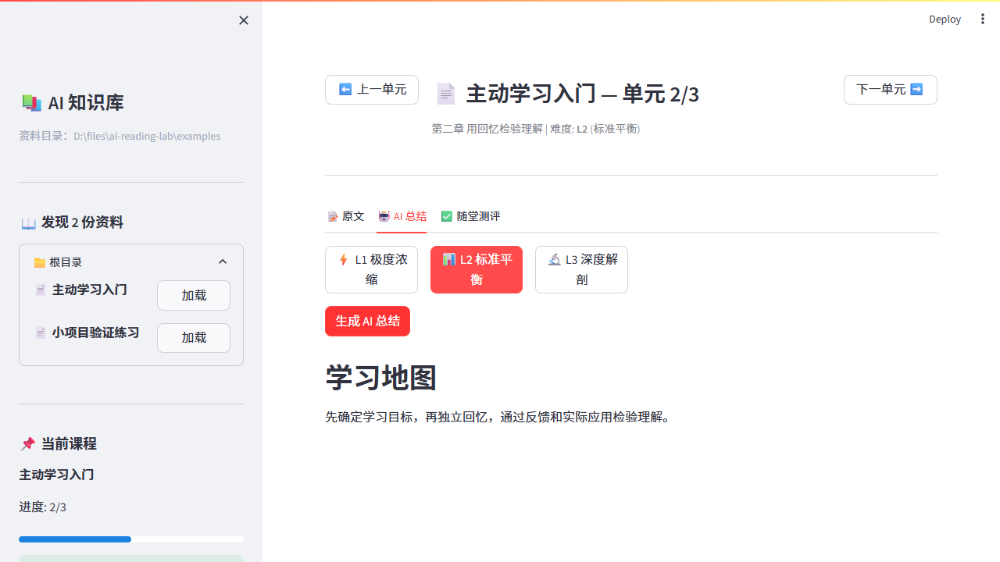

# AI Reading Lab

用 AI 带着学习本地资料：分层讲解、主动回答、反馈和间隔复习。

Learn from local books with layered explanations, quizzes, feedback and spaced review. A small Python CLI and Streamlit app, with an OpenAI-compatible model API of your choice.

## 它能做什么

- 读取一本书或一个目录中的多份 TXT、DOCX、文本型 PDF。
- 把内容拆成学习单元，按 L1 精简、L2 标准、L3 深入生成讲解。
- 生成理解、应用与批判思考题，对回答给出反馈。
- 根据评分调整后续讲解深度，记录进度并安排间隔复习。
- 批量整理各单元笔记和全书知识地图。

这是一套可继续开发的个人学习原型。它支持多份资料作为一个课程，但还没有跨书向量检索、逐页引用或概念级掌握度模型。AI 评分用于辅助自学，不作为正式考试成绩。

## 快速开始

需要 Python 3.10+。从源码运行：

```bash
git clone https://github.com/SmallHorseBrother/ai-reading-lab.git
cd ai-reading-lab
python -m venv .venv
```

激活环境：Windows PowerShell 使用 `.\.venv\Scripts\Activate.ps1`；macOS/Linux 使用 `source .venv/bin/activate`。安装需要的组件：

```bash
python -m pip install -e ".[web,documents]"
```

只使用 TXT 命令行时，执行 `python -m pip install -e .` 即可。

**先免费检查解析，不需要 API key：**

```bash
python cli.py --input "examples/主动学习入门.txt" --mode book --preview
```

`examples/` 中的两份中文资料为本项目原创示例，不包含商业书籍。`--preview` 只显示单元列表，不调用模型，也不创建学习进度。

## 配置模型

将 `.env.example` 复制为 `.env`，填写自己的 OpenAI 兼容服务配置：

```dotenv
OPENAI_API_KEY=你的密钥
OPENAI_BASE_URL=https://api.openai.com/v1
OPENAI_MODEL=服务商提供的实际模型ID
```

程序不绑定某个模型版本，也不读取私人 Skill 或其他软件中的密钥。已有环境变量优先于 `.env`。模型接口需要支持 Chat Completions、`temperature` 和 `max_tokens`；部分服务的参数要求不同，可能需要相应适配。

生成讲解、出题和评分会把相应原文片段及回答发送到你配置的服务商，并可能产生 API 费用。直接读取和预览原文不调用模型。请自行确认所用资料的处理权限和服务商的数据政策。

## 网页使用

```bash
python -m streamlit run frontend/streamlit_app.py
```

1. 在左侧加载一份示例资料。
2. 在“原文”查看学习单元。
3. 在“AI 总结”选择讲解深度，点击“生成 AI 总结”。
4. 在“随堂测评”生成题目、回答并提交，查看反馈与复习安排。



截图使用原创示例和模拟模型响应展示交互，不代表真实模型的效果评测。

加载资料或切换单元不会自动发起模型请求。默认只监听 `127.0.0.1`，面向本机单人使用，没有账号或多用户隔离功能。

默认资料目录是 `examples/`，学习进度和生成内容保存在 `data/`。使用自己的资料时，可以在 `.env` 中设置：

```dotenv
AI_LIBRARY_DIR=/absolute/path/to/your/books
AI_OUTPUT_DIR=/absolute/path/to/your/learning-data
```

Windows 路径也可使用正斜线，例如 `D:/Books`。个人书籍可放在已忽略的 `library/` 中，并将 `AI_LIBRARY_DIR` 指向它。

## 命令行使用

```bash
# 逐单元学习、回答和保存进度
python cli.py --input "examples/主动学习入门.txt" --mode book --study

# 把一个目录中的多份资料作为同一课程学习
python cli.py --input examples --mode book --study

# 主动调用模型，生成各单元总结和知识地图
python cli.py --input "examples/主动学习入门.txt" --mode book --batch

# 查看统计
python cli.py --course "主动学习入门" --stats

# 用原始资料开始到期复习
python cli.py --input "examples/主动学习入门.txt" --mode book --review
```

默认输入路径会执行批量生成；如果只想检查文件，请明确加上 `--preview`。使用 `--output` 可以为命令行指定独立输出目录。支持的模式为 `book`、`video`、`creator` 和 `article`。

## 项目结构

```text
core/           文档加载、分块、提示模板、模型调用、进度和复习
frontend/       Streamlit 界面
examples/       原创演示资料
tests/          离线定向测试，无付费 API 请求
docs/           设计说明和参考项目
cli.py          命令行入口
```

学习记录、缓存和 `.env` 不进入版本库。模型失败或返回无效评分时，不会生成一个默认分数写入学习历史；缓存按模型区分。

## 当前边界

- 扫描 PDF 不含可抽取文字时，需要先在外部完成 OCR。
- 章节识别依赖启发式规则；目录、特殊排版和复杂表格可能影响结果，应先预览。
- 测验可能附带参考答案，适合自学反馈，不是防作弊测评。
- 自适应深度目前是课程级别，不代表每个概念都建立了掌握度模型。
- 没有原文页码锚点；生成的总结、引用和评价需要人工核对。
- 多份资料共用课程状态。资料顺序或内容改变后，建议换用新的输出目录，避免旧单元编号对应到新内容。

后续方向是“全书地图 → 学习诊断 → 个性路线 → 概念练习 → 回到原文 → 复习”，见[设计说明](docs/DESIGN.md)。

## 开发与贡献

```bash
python -m pip install -e ".[web,documents,dev]"
python -m pytest tests -q
```

测试使用原创资料和模拟模型响应，不会读取个人书库或发起付费请求。贡献前请阅读 [CONTRIBUTING.md](CONTRIBUTING.md)。

## 参考与许可证

本项目从个人 AI 学习原型整理而来。曾比较多个开源阅读和学习项目，清单见[参考项目](docs/REFERENCES.md)。本仓库不包含这些项目的克隆、依赖环境、个人书籍或历史聊天记录。

自研代码和原创示例以 [MIT](LICENSE) 发布。第三方依赖各自适用其许可证，尤其文档解析和阅读器项目的许可不因本仓库的 MIT 许可证而改变。
